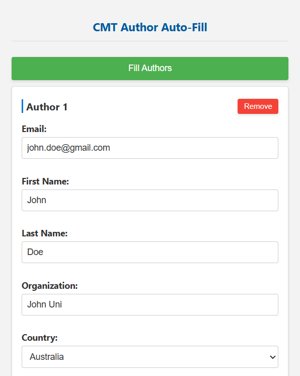
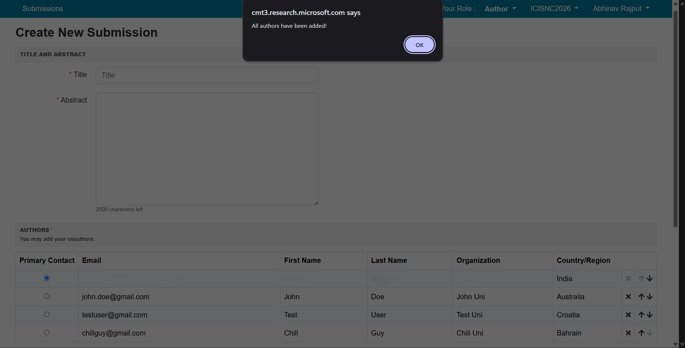

# CMT Author Auto-Fill Chrome Extension

A Chrome extension that automates the process of filling author details in the Microsoft Conference Management Toolkit (CMT). This tool allows users to save, load, and auto-fill up to 4 authors' information (Email, First Name, Last Name, Organization, and Country) into the CMT form.

---

## **Features**

- **Save Author Details**: Save up to 4 authors' information for reuse.
- **Load Author Details**: Load saved author information into the extension.
- **Auto-Fill Form**: Automatically fill the author details sequentially in the CMT form with a single click.
- **Modern UI**: A user-friendly and responsive popup interface.

---

## **Screenshots**

### **Extension Popup Interface**

This is the popup interface where users can input author details and initiate the auto-fill process.

<div style="text-align: center;">
    
</div>

### **CMT Auto-Fill in Action**

This screenshot shows the auto-filled author details in the CMT submission form after using the extension.



---

## **Installation**

1. **Clone or Download** the repository to your local machine:

   ```bash
   git clone https://github.com/arya2004/cmt-autofill.git
   ```

2. **Build the extension** with Node.js 24 (see `.nvmrc`):

   ```bash
   nvm use
   npm ci
   npm run build
   ```

3. **Open Chrome** and navigate to:

   ```
   chrome://extensions
   ```

4. **Enable Developer Mode**:
   - Toggle the developer mode switch at the top-right corner.

5. **Load the Extension**:
   - Click on the "Load unpacked" button.
   - Select `dist/extension/` inside this repository.

6. The extension will now be visible in your Chrome toolbar.

---

## **Usage**

### **Step 1: Save Author Details**

- Click the extension icon to open the popup.
- Fill in the author details (Email, First Name, Last Name, Organization, and Country) for up to 4 authors.
- Click the **Save Authors** button to store the information.

### **Step 2: Load Saved Details**

- If you've saved author details before, click the **Load Authors** button to populate the fields with saved data.

### **Step 3: Auto-Fill Form**

- Navigate to the CMT submission page.
- Click the **Auto-Fill Authors** button in the extension popup.
- The extension will sequentially:
  - Click the "Add Author" button.
  - Fill the details for each author.
  - Submit the form for each author.

---

## **Supported Fields**

Each author includes the following details:

- **Email**
- **First Name**
- **Last Name**
- **Organization**
- **Country**

---

## **License**

This project is licensed under the [CC BY-NC-ND 4.0](LICENSE).

---

## Development

Use Node.js 24 and npm. Run `npm ci` after cloning.

| Command                | Purpose                                                           |
| ---------------------- | ----------------------------------------------------------------- |
| `npm run dev`          | Build and watch the popup and content script in `dist/extension/` |
| `npm run lint`         | Check source and tooling with ESLint                              |
| `npm run format-check` | Check formatting with Prettier                                    |
| `npm run format`       | Apply formatting                                                  |
| `npm run typecheck`    | Check strict TypeScript types                                     |
| `npm run build`        | Typecheck and build the production extension                      |

Load `dist/extension/` through Chrome's **Load unpacked** control. After a watched
build, reload the extension at `chrome://extensions`, reopen its popup, and refresh
the target tab to load the new content script. Restart `npm run dev` after changing
`manifest.json`; the manifest is copied when the build starts. Development uses
bundles on disk, without a development server or hot reload.

Source layout:

- `src/popup/`: React entry, popup components, styles, and temporary jQuery bridge.
- `src/storage/`: Chrome sync storage access using the existing profile format.
- `src/shared/`: TypeScript models shared by popup and CMT integration.
- `src/cmt/`: Content-script entry and existing author automation.
- `scripts/build.mjs`: Vite popup build and standalone content-script bundle.
- `manifest.json`: Manifest V3 source; generated paths refer to build output.

The build follows [Vite's production build modes](https://vite.dev/guide/build)
and uses [strict TypeScript checking](https://www.typescriptlang.org/tsconfig/strict.html).
Generated files and dependencies are ignored by Git. The React host deliberately
retains the existing jQuery interface until plan item 3. Profile validation,
storage migration, permission changes, and automation reliability are later plan
items; this build step preserves their current behavior.

The lockfile overrides TypeScript ESLint's transitive `minimatch` to the patched
11.x release because its upstream 10.x range includes a known denial-of-service
advisory. Recheck this override when upgrading TypeScript ESLint.

If Fill Authors reports a connection error, reload the extension at
`chrome://extensions` after rebuilding, then reopen the CMT submission tab and
try again. The popup now checks that the content script is listening and injects
it into the active CMT tab when missing. It reports a refresh instruction if
Chrome denies access or the page navigates during the connection.
